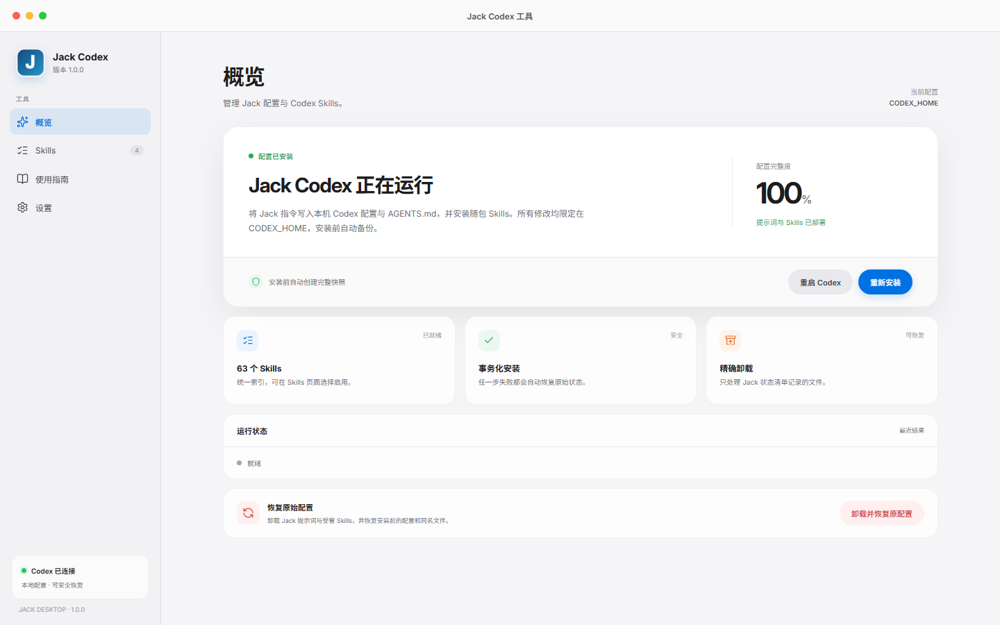

# Jack Codex 工具

仅面向 Codex 的本地桌面配置工具。应用把唯一提示词 `jack-codex-v1.md` 和随包 `codex-skills` 安装到当前 `CODEX_HOME`，不读取或修改其他开发工具配置。

## 界面



正式界面包含概览、Skills、使用指南和设置。概览页提供安装、重新安装、重启 Codex，以及带二次确认的“卸载并恢复原配置”。

## 安装行为

默认目录为 `%USERPROFILE%\.codex`；设置了 `CODEX_HOME` 时使用环境变量指定的目录。

安装器只管理以下内容：

- `config.toml` 中的 `model_instructions_file` 单行；
- `AGENTS.md` 中 `JACK-CODEX-INJECT` 标记块；
- `managed-prompts/jack-codex-v1.md`；
- 随包一级 Skills 目录；
- `.jack-codex/install-state.json` 与精确备份。

同名的用户 Skill 会先移动到 `.jack-codex/backups`。卸载按状态清单恢复，不删除其他 Skills 或无关的 `[[skills.config]]`。

## 开发

```powershell
npm install
npm run build
npm test
npm run dev
npm run dev:electron
```

## 手动测试安装器

```powershell
$env:CODEX_HOME = 'C:\path\to\test-codex-home'
powershell.exe -NoLogo -NoProfile -File .\install.ps1 -Action Install
powershell.exe -NoLogo -NoProfile -File .\install.ps1 -Action Uninstall
```

回归测试始终使用临时 `CODEX_HOME`：

```powershell
npm run test:installer
```

## 打包

```powershell
npm run dist
```

产物写入 `release/`：

- `Jack-Codex-Setup-<version>.exe`
- `Jack-Codex-Portable-<version>.exe`

NSIS 和便携卸载流程会先调用状态清单卸载，再移除应用自身文件。

## 安全边界

- Electron 渲染层启用 sandbox、context isolation，并禁用 Node integration。
- IPC 固定为 Codex 安装、卸载、Skills、状态、窗口和重启操作。
- PowerShell 不使用 `/MIR`、驱动器扫描或其他平台目录扫描。
- 安装源必须位于应用资源根目录，目标必须位于解析后的 `CODEX_HOME`。

## License

MIT，详见 [LICENSE](LICENSE)。修改归属与第三方说明见 [NOTICE.md](NOTICE.md)。
